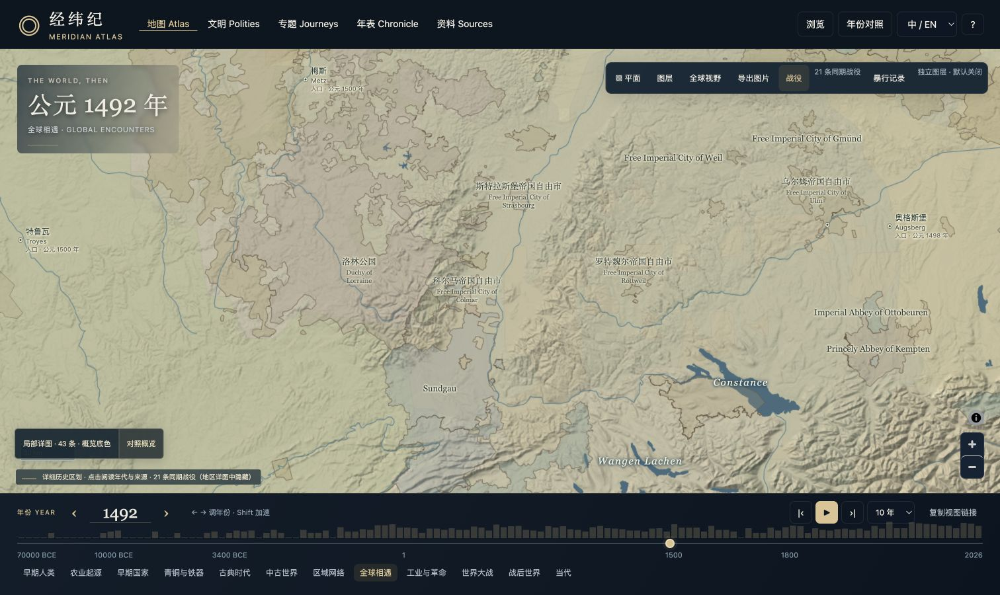

# 经纬纪 · Meridian Atlas

中英文双语世界历史图集。沿时间轴浏览历史疆域，在地形与城市之间探索国家、文明、事件及原始资料。

**当前版本：3.52.0** · [交接与验证记录](docs/HANDOFF-3.52.md) · [文档导航](docs/INDEX.md) · [来源与许可](ATTRIBUTIONS.md)



## 功能

- 全球历史疆域与年份切换，地球／平面投影、双年份对照、图层开关和视图分享。
- 简体中文、英文和双语阅读；国家档案包含概览、政治、文化与经济、疆域、城市、年表和来源栏目。
- 历史事件、古代地点、离散城市人口记录、有据遗址与城市篇章；现代地形和地理参照单独组织。
- 放大自动显示已有地区详图；历史边界优先加载，支持无损传输、原始记录下载和来源追溯。
- 资料页提供全目录身份核查台账与30份代表档案证据盘点；全球边界按缩放级别加载显示精度，保留完整原始坐标。

## 本地运行

安装 Python 3，在项目目录运行：

```sh
git clone https://github.com/zhuozheng2006/meridian-atlas.git
cd meridian-atlas
python3 serve.py --port 8767
```

浏览器打开 <http://127.0.0.1:8767/>。本地预览使用 Python 标准库，不需要先安装 npm 依赖；macOS 也可使用 `打开经纬纪.command`。

历史数据和已固化的地图资源随仓库保存，因此仓库体积较大。在线高精度地形、现代参照和部分外部图层仍需要网络。这里的“本地运行”不意味着所有在线服务都能离线使用。

## 开发与验证

最近验证环境为 Node.js 26、Python 3.9。修改前端后更新资源版本戳：

```sh
npm run prepare:assets
npm test
npm run test:http
npm run build
```

构建产生 `dist/`。现有云端部署还使用 R2 分发大型资料，不能只复制 `dist/client/` 就得到完整云端部署；见[部署与数据说明](docs/DEVELOPMENT.md)。重新采集或处理数据时，各专题脚本目录有独立的依赖说明。

## 项目结构

| 目录 | 内容 |
| --- | --- |
| `public/` | 页面、地图与阅读器代码、打包的数据和本地资源 |
| `editorial/` | 人工整理的名称、叙述与资料编排 |
| `scripts/` | 数据处理、资源生成、验证与构建 |
| `worker/` | 云端 Worker 和大型资料分发 |
| `docs/` | 交接、设计、资料审计、测试与发布证据 |
| `docs/experiments/3.48/` | 未采用的性能实验快照，独立于产品 |

## 范围与来源

全球疆域档案主要覆盖公元前3400年至公元2024年；事件时间轴延伸到史前和当代。不同地区、年代与图层的覆盖和精度并不一致。现代地形不是古代地貌重建，年度边界也不等于逐日政治疆域。详细范围和剩余问题集中记录在[当前交接](docs/HANDOFF-3.52.md)。

原创应用代码采用 MIT；历史数据、原始文献、字体及第三方库各自保留其来源和许可，包括部分非商业数据。具体见 [LICENSE](LICENSE) 和 [ATTRIBUTIONS.md](ATTRIBUTIONS.md)。

[现有在线站点](https://meridian-world-history.zhuozheng2006.chatgpt.site)沿用仅所有者可访问的设置。公开源码仓库不改变该站点的访问范围。

## English

Meridian Atlas is a bilingual world-history atlas combining dated territories, events, places, polity dossiers, source-linked reading, and geographic reference layers. The interface supports Simplified Chinese, English, and bilingual display.

Run locally with `python3 serve.py --port 8767`. Bundled historical data is included; optional online layers require a network connection. Original application code is MIT licensed; datasets and third-party materials retain their individual terms. See the documentation and attribution links above for coverage, reproducibility, and known limitations.
