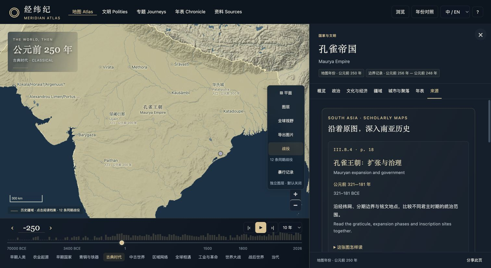

# 经纬纪 · Meridian Atlas

中英文双语世界历史图集。沿时间轴浏览历史疆域，在地形与城市之间探索国家、文明、事件及原始资料。

**当前版本：4.15.0** · [交接与验证记录](docs/HANDOFF-4.15.md) · [文档导航](docs/INDEX.md) · [来源与许可](ATTRIBUTIONS.md)



## 功能

- 全球历史疆域与年份切换，地球／平面投影、双年份对照、图层开关和视图分享。
- 简体中文、英文和双语阅读；国家档案包含概览、政治、文化与经济、疆域、城市、年表和来源栏目。
- 历史事件、古代地点、离散城市人口记录、有据遗址与城市篇章；通过 `PLACE_ZH_EDITORIAL` 派生映射为 **841 处**上古文明腹地与近世城镇（实现 Chandler / Modelski 全量非隔离 `urban-observations` 城市 100% 中文名覆盖）及高频古典聚落（Pleiades `ref >= 20`）补齐权威中文名称，并将 **13 条**经纬度或半球符号错位的上游条目纳入 `PLACE_COORD_QUARANTINE` 隔离，同时保留原始档案只读不变；现代地形和地理参照单独组织。
- 多图层精确避让与双语检索分级：[`PlaceLayer.refresh()`](public/places.js) 综合三行字符与人口年份标尺测量实际宽度以消除密集区城市徽标碰撞，[`AtlasMap.refreshLabels()`](public/map-engine.js) 同步重算战役与暴行点位与政体标签／图钉间隙并在镜头平移／缩放过程维持 50 ms 动态避让与球面地平线剔除，侧栏搜索按“政体检索 -> 城市与遗址（精选 Top 6）-> 历史事件 -> 战役”分层排序。
- 新增西亚罗马时期详图：公元117、200年AWMC疆域与200年行省线，保留原始坐标和来源下载。
- 汉唐名称逐条核查全量 420 项（已核准 **369 项**：西汉全量 **103 / 103**，盛唐 **266 / 317**；`51` 项存疑备考条目中已逐条核实引证 **46 / 51** 项，累计正史文献覆证 **415 / 420**），按《汉书·卷二十八》、《旧唐书》、《新唐书》、《通典·州郡》与《康熙字典》字书音义多源互证显示当年名称、原始标签及文献考证链接。
- 南亚学术地图研读入口：孔雀王朝、笈多与伐迦陀迦及早期大国三组馆藏高清图版，附线性/非线性多项式配准敏感性与 9 处 Pleiades 站点叠合残差审计及跨时代全球年表核查；保留分期、图例与来源说明。
- 首屏按 25 年分包、精简事件索引（40.6 KB）、全时段政体检索索引（78 KB）与 64 桶分片加载，内容指纹拆分出仅 **1.55 KB** 的 [`bootstrap-content-hashes.js`](public/bootstrap-content-hashes.js) 并在 `<head>` 提前 `modulepreload`，使 `1.5 Mbps / 150ms` 弱网下核心年度疆域包较 `v3.70` 再提前 ~159 ms 发起；移除 `<head>` 对非首屏关键路径的 `maplibre-gl.css` 阻塞，使 `maplibre-gl.js`（247 KB）率先进入首波并发通道（研究模式 `#view=research` 零地图 CSS/JS 传输）。
- 黑曜石×黄铜风格全界面设计：主地图采用磨砂黑曜石 `.map-heading` 年份题签卡与胶囊拨片开关、毛玻璃 `.map-notice` 与 `.regional-controls`、质感胶囊化 `.maplibregl-ctrl-scale` 比例尺、顶部金线悬停放大卡 `.map-hover-card`、Obsidian × Brass 地区详情浮窗 `.historical-popup`（含胶囊来源链接）、专题导览 `.story-bar` 进度条与分步导航控制器、卡片化地点／政体／检索／研究（`.seshat-research-reader`）抽屉与 `<kbd>` 快捷键帮助窗 `#helpDialog`、双图对比年份差徽章与一键互换、移动端时代栏自动居中与年表／资料页统一卡片表格系统。
- 387个概览与地区详图压缩文件使用内容指纹缓存；概览边界复用绘制结果，减少重复计算。
- 汉唐历史区划：公元 2 年、742 年的 420 条研究单元，补充北部与西部，按地理分区读取原始精度边界。
- CHGIS V4 历史府级区划：2,016 条原始记录，覆盖中国南部与东部的部分地区，按公元前 224 年至 1911 年的来源年度读取。
- 放大自动显示已有地区详图；历史边界优先加载，支持无损传输、原始记录下载和来源追溯。
- 资料页提供全目录身份核查台账与30份代表档案证据盘点；全球边界按缩放级别加载显示精度，保留完整原始坐标。

## 本地运行

安装 Python 3，在项目目录运行：

```sh
git clone https://github.com/zhuozheng2006/meridian-atlas.git
cd meridian-atlas
python3 serve.py --port 8767
```

浏览器打开 <http://127.0.0.1:8767/>。本地预览使用 Python 标准库，不需要先安装 npm 依赖；macOS 也可使用 `打开经纬纪.command`。

历史数据和已固化的地图资源随仓库保存，因此仓库体积较大。在线高精度地形、现代参照和部分外部图层仍需要网络。这里的“本地运行”不意味着所有在线服务都能离线使用。

## 开发与验证

最近验证环境为 Node.js 26、Python 3.9。修改前端后更新资源版本戳：

```sh
npm run prepare:assets
npm test
npm run test:http
npm run build
```

构建产生 `dist/`。现有云端部署还使用 R2 分发大型资料，不能只复制 `dist/client/` 就得到完整云端部署；见[部署与数据说明](docs/DEVELOPMENT.md)。重新采集或处理数据时，各专题脚本目录有独立的依赖说明。

## 项目结构

| 目录 | 内容 |
| --- | --- |
| `public/` | 页面、地图与阅读器代码、打包的数据和本地资源 |
| `editorial/` | 人工整理的名称、叙述与资料编排 |
| `scripts/` | 数据处理、资源生成、验证与构建 |
| `worker/` | 云端 Worker 和大型资料分发 |
| `docs/` | 交接、设计、资料审计、测试与发布证据 |
| `docs/experiments/3.48/` | 未采用的性能实验快照，独立于产品 |

## 范围与来源

全球疆域档案主要覆盖公元前3400年至公元2024年；事件时间轴延伸到史前和当代。不同地区、年代与图层的覆盖和精度并不一致。现代地形不是古代地貌重建，年度边界也不等于逐日政治疆域。详细范围和剩余问题集中记录在[当前交接](docs/HANDOFF-3.84.md)。

原创应用代码采用 MIT；历史数据、原始文献、字体及第三方库各自保留其来源和许可，包括部分非商业数据。具体见 [LICENSE](LICENSE) 和 [ATTRIBUTIONS.md](ATTRIBUTIONS.md)。

[现有在线站点](https://meridian-world-history.zhuozheng2006.chatgpt.site)沿用仅所有者可访问的设置。公开源码仓库不改变该站点的访问范围。

## English

Meridian Atlas is a bilingual world-history atlas combining dated territories, events, places, polity dossiers, source-linked reading, and geographic reference layers. The interface supports Simplified Chinese, English, and bilingual display.

Run locally with `python3 serve.py --port 8767`. Bundled historical data is included; optional online layers require a network connection. Original application code is MIT licensed; datasets and third-party materials retain their individual terms. See the documentation and attribution links above for coverage, reproducibility, and known limitations.
